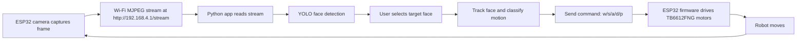

# Face-Follower-ESP32S3Sense

A small face-following robot built around the XIAO ESP32S3 Sense camera module
and a TB6612FNG motor driver. The ESP32 hosts its own Wi-Fi access point,
streams camera frames as MJPEG, and receives drive commands from a desktop
Python app that performs YOLO face detection and closed-loop tracking.

## What this repo contains

- `espcam.cpp` — Arduino/ESP32 firmware for the robot
- `esp_app.py` — self-contained Tkinter desktop app containing the MJPEG/TCP
  transport, YOLO detection, target selection, recognition, and movement logic
- `yolo/` — local YOLO face model files
- `memory/` — persistent JSON face memories, including the active `target`

## Features

- Live MJPEG camera stream from the ESP32
- Click-to-select face tracking in a desktop app
- YOLO face detection with spatial, geometric, and embedding-based reacquisition
- Optional ArcFace embeddings for stored face recognition
- Persistent target and familiar-face memories under `memory/`
- Closed-loop movement control for centering and following a face
- Simple Wi‑Fi robot control over TCP: forward, backward, turn left, turn right, stop
- Optional model downloads for supported YOLO face variants

## Hardware overview

This project assumes a robot chassis with:

- XIAO ESP32S3 Sense board with camera module
- TB6612FNG dual motor driver
- 2 DC motors and wheels
- 5V power supply for the motors and board

The firmware wires the driver pins to the ESP32 exposed GPIOs and exposes a Wi‑Fi AP named `XIAO-ESP32S3` by default.

## Typical network layout

- Camera stream: `http://192.168.4.1/stream`
- Robot command port: `192.168.4.1:8080`
- Desktop app connects to the robot over Wi‑Fi directly, without a router

## Quick assembly checklist

Use this checklist before powering on the robot:

- [ ] XIAO ESP32S3 Sense is mounted and the camera ribbon is seated correctly
- [ ] TB6612FNG motor driver is connected to the GPIO pins defined in `espcam.cpp`
- [ ] Left and right motors are wired to the correct driver outputs
- [ ] Motor power and logic power are connected to a stable supply
- [ ] The robot chassis is free to move without wheel binding
- [ ] The ESP32 serial monitor is connected and the board boots cleanly
- [ ] The Wi‑Fi AP SSID/password matches the laptop connection settings

## Control flow diagram



## Quick start

### 1) Flash the ESP32 firmware

Open `espcam.cpp` in the Arduino IDE (or your preferred ESP32 build environment) and set the board to the XIAO ESP32S3 / ESP32S3 target.

Then update the Wi‑Fi settings near the top of the file:

```cpp
const char *AP_SSID = "XIAO-ESP32S3";
const char *AP_PASS = "12345678";
```

Use a password of at least 8 characters, or set it to an empty string for an open network.

Upload the sketch to the XIAO ESP32S3 Sense.

### 2) Connect your laptop to the robot Wi‑Fi

After startup, the board creates an access point. Connect your computer to the SSID you configured.

The app expects the default ESP32 IP address to remain `192.168.4.1`.

### 3) Prepare the Python environment

From the repo root:

```bash
python3 -m venv .venv
source .venv/bin/activate
python -m pip install opencv-python pillow ultralytics
```

ArcFace support is optional. Install InsightFace and its runtime if you want
embedding-based familiar-face recognition:

```bash
python -m pip install insightface onnxruntime
```

Without InsightFace, the app uses its built-in image-statistics embedding
fallback. This is suitable for basic target tracking but is less reliable for
recognizing people across different views.

The repository includes supported model files under `yolo/`. The app can also
download a missing supported model from the model selector.

### 4) Run the desktop app

```bash
python3 esp_app.py
```

The GUI opens with the default model selected and begins loading it in the
background. After the model status shows `Ready`, press `Connect` to open the
MJPEG stream and robot command connection.

### 5) Use the app

1. Connect the computer to the ESP32 access point.
2. Load the selected YOLO model, downloading it if necessary.
3. Press `Connect` and wait for the live stream.
4. Click a detected face to select it as the target.
5. Adjust the confidence threshold if detection is too sensitive or misses
   faces.
6. Press `Stop robot` or `Esc` to stop movement and clear the target.

The app first tries to reacquire the target by overlap and proximity, then by
the learned face profile. If no target is found for a prolonged period,
tracking is released. Selecting a face creates or refreshes the persistent
`target` memory.

## Command format

The robot firmware accepts simple commands over TCP:

- `w` — move forward
- `s` — move backward
- `a` — turn left
- `d` — turn right
- `p` — stop

The desktop app sends values like:

```text
w, 150
s, 120
a, 180
d, 180
p, 0
```

The second value is the PWM/speed command in the range `0..255`.

## File map

- `esp_app.py` — desktop UI, transport, face detection, classification, and
  tracking logic
- `espcam.cpp` — XIAO ESP32S3 firmware
- `tests/test_core.py` — unit tests for memory serialization, geometry, and
  command framing
- `docs/USAGE.md` — operating instructions and troubleshooting
- `docs/HOW-IT-WORKS.md` — architecture and control-loop details

## Common troubleshooting

### Camera stream not opening

- Confirm the robot Wi‑Fi is connected.
- Check that the XIAO board is running the firmware without camera init errors.
- Verify the stream URL in the app matches the board IP, typically `http://192.168.4.1/stream`.

### No face detected

- Lower the confidence threshold in the GUI.
- Try a different YOLO model from the model dropdown.
- Make sure the face is well-lit and fully visible.
- Confirm the selected model status says `Ready` before connecting.

### Robot does not move

- Confirm the motor driver pins are correctly wired.
- Check the board serial log for `Robot cmd:` messages.
- Ensure the XIAO board is connected to the same Wi‑Fi network as the app.

## Notes

This project is intended as a compact embedded vision robot demo rather than a production-ready autonomous robot stack. The logic is intentionally simple and uses direct camera feedback from a single face target.

The desktop app owns the computationally expensive work. The ESP32 only
captures/streams frames and applies the movement commands it receives.

If you want to extend it, the most natural next steps are:

- add obstacle avoidance
- support multiple face tracking
- expose more tuning parameters through the app
- add a more robust robot state machine
