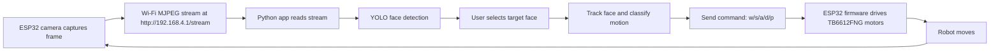

# Face-Follower-ESP32S3Sense

A small face-following robot built around the XIAO ESP32S3 Sense camera module and a TB6612FNG motor driver. The ESP32 hosts its own Wi‑Fi access point, streams camera frames as MJPEG, and receives drive commands from a desktop Python app that runs YOLO-based face detection and tracking.

## What this repo contains

- `espcam.cpp` — Arduino/ESP32 firmware for the robot
- `espstream.py` — MJPEG stream client and TCP robot command client
- `espyolo.py` — YOLO model loading, detection, target matching, and movement classification
- `esp_app.py` — Tkinter desktop control app with live video, target selection, and controls
- `yolo/` — local YOLO face model files

## Features

- Live MJPEG camera stream from the ESP32
- Click-to-select face tracking in a desktop app
- YOLO face detection with target memory and profile matching
- Closed-loop movement control for centering and following a face
- Simple Wi‑Fi robot control over TCP: forward, backward, turn left, turn right, stop
- Optional model downloads for supported YOLO face variants

## Hardware overview

This project assumes a robot chassis with:

- XIAO ESP32S3 Sense board with camera module
- TB6612FNG dual motor driver
- 2 DC motors and wheels
- 5V power supply for the motors and board

The firmware wires the driver pins to the ESP32 exposed GPIOs and exposes a Wi‑Fi AP named `XIAO-ESP32S3` by default.

## Typical network layout

- Camera stream: `http://192.168.4.1/stream`
- Robot command port: `192.168.4.1:8080`
- Desktop app connects to the robot over Wi‑Fi directly, without a router

## Quick assembly checklist

Use this checklist before powering on the robot:

- [ ] XIAO ESP32S3 Sense is mounted and the camera ribbon is seated correctly
- [ ] TB6612FNG motor driver is connected to the GPIO pins defined in `espcam.cpp`
- [ ] Left and right motors are wired to the correct driver outputs
- [ ] Motor power and logic power are connected to a stable supply
- [ ] The robot chassis is free to move without wheel binding
- [ ] The ESP32 serial monitor is connected and the board boots cleanly
- [ ] The Wi‑Fi AP SSID/password matches the laptop connection settings

## Control flow diagram



## Quick start

### 1) Flash the ESP32 firmware

Open `espcam.cpp` in the Arduino IDE (or your preferred ESP32 build environment) and set the board to the XIAO ESP32S3 / ESP32S3 target.

Then update the Wi‑Fi settings near the top of the file:

```cpp
const char *AP_SSID = "XIAO-ESP32S3";
const char *AP_PASS = "12345678";
```

Use a password of at least 8 characters, or set it to an empty string for an open network.

Upload the sketch to the XIAO ESP32S3 Sense.

### 2) Connect your laptop to the robot Wi‑Fi

After startup, the board creates an access point. Connect your computer to the SSID you configured.

The app expects the default ESP32 IP address to remain `192.168.4.1`.

### 3) Prepare the Python environment

From the repo root:

```bash
python3 -m venv .venv
source .venv/bin/activate
pip install opencv-python pillow ultralytics
```

If needed, install the exact model files under `yolo/` before running the app. You can also use the app’s model selection and download behavior.

### 4) Run the desktop app

```bash
python esp_app.py
```

The GUI opens a control panel and live video window. It will try to load the configured model and then connect to the MJPEG stream.

### 5) Use the app

- Click a face in the live image to make it the tracked target.
- The app keeps a profile of the selected face and tries to reacquire it if it briefly disappears.
- The robot adjusts steering and forward/backward movement until the target stays centered.
- Use the model picker and confidence slider to tune detection behavior.
- Press `Esc` to stop the robot immediately.

## Command format

The robot firmware accepts simple commands over TCP:

- `w` — move forward
- `s` — move backward
- `a` — turn left
- `d` — turn right
- `p` — stop

The desktop app sends values like:

```text
w, 150
s, 120
a, 180
d, 180
p, 0
```

The second value is the PWM/speed command in the range `0..255`.

## File map

- `esp_app.py` — desktop UI and control loop
- `espstream.py` — Open MJPEG stream and socket command transport
- `espyolo.py` — face detection, classification, and tracking logic
- `espcam.cpp` — XIAO ESP32S3 firmware

## Common troubleshooting

### Camera stream not opening

- Confirm the robot Wi‑Fi is connected.
- Check that the XIAO board is running the firmware without camera init errors.
- Verify the stream URL in the app matches the board IP, typically `http://192.168.4.1/stream`.

### No face detected

- Lower the confidence threshold in the GUI.
- Try a different YOLO model from the model dropdown.
- Make sure the face is well-lit and fully visible.

### Robot does not move

- Confirm the motor driver pins are correctly wired.
- Check the board serial log for `Robot cmd:` messages.
- Ensure the XIAO board is connected to the same Wi‑Fi network as the app.

## Notes

This project is intended as a compact embedded vision robot demo rather than a production-ready autonomous robot stack. The logic is intentionally simple and uses direct camera feedback from a single face target.

If you want to extend it, the most natural next steps are:

- add obstacle avoidance
- support multiple face tracking
- expose more tuning parameters through the app
- add a more robust robot state machine
