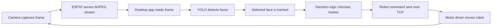

# How It Works

This project is a simple embedded computer-vision control loop. The architecture splits cleanly into three parts:

1. the ESP32 robot firmware
2. the Python vision and control app
3. the YOLO-based face tracking logic

## 1. Robot firmware

The firmware in `espcam.cpp` does three main jobs:

- initializes the camera
- starts a Wi‑Fi access point
- exposes a live MJPEG stream and a TCP command listener

### Camera stream

The camera captures frames and stores the latest JPEG in memory. An HTTP server exposes the stream at `/stream` using multipart MJPEG output. The Python app reads this stream with `MjpegStream` in `espstream.py`.

### Motor control

The firmware also manages the motor driver. It accepts commands such as:

```text
w, 180
s, 140
a, 220
d, 220
p, 0
```

The commands are mapped to `TB6612FNG` pins and drive the left and right motors with PWM. The code uses a straightforward tank-drive model instead of a full robotics framework.

### Wi‑Fi access point

The board runs in AP mode, so a laptop just connects to the robot directly. That keeps the project simple and avoids needing a router or external network.

## 2. Stream transport layer

The Python file `espstream.py` contains two classes:

- `MjpegStream` — opens the stream and extracts JPEG frames from the multipart data
- `RobotCommandClient` — sends simple commands to the robot over TCP

This layer is intentionally small and low-level. It handles network I/O and leaves the higher-level logic to the GUI and detection stack.

## 3. Vision and tracking logic

`espyolo.py` is the core of the robot behavior.

### Model loading

The script loads a YOLO face model from the local `yolo/` directory or a download URL. Supported models include:

- `yolo26n-face.pt`
- `yolov8n-face.pt`
- `yolov10n-face.pt`

### Detection

Each video frame is passed through the YOLO model. The detector returns bounding boxes for faces with their confidence scores.

### Target selection

The user clicks a face in the live app. The app stores that face as the selected target and records a profile that includes:

- relative size within the frame
- aspect ratio
- HSV color histogram of the face crop

This profile becomes the “memory” used for reacquiring the face if it temporarily goes out of frame or is partially occluded.

### Decision making

Once a selected face is known, the code compares the target center to the frame center. The resulting decision can be:

- `LEFT` or `RIGHT` — rotate to center the face horizontally
- `CLOSE` or `FAR` — move forward or backward to adjust distance
- `GOOD` — keep the robot stopped
- `NO TARGET` — no valid tracked face

This decision is translated into a command like `a`, `d`, `w`, `s`, or `p` and the speed is adjusted based on how far the target is offset from center.

## 4. Desktop control application

`esp_app.py` is a Tkinter app that ties the stream, model, user interaction, and motor control together.

### UI flow

The app displays:

- main video canvas
- a small preview of the target crop
- status indicators for detection and connection
- controls for model loading and confidence tuning
- a log panel and decision state

The user chooses a face by clicking on the frame. Then the worker thread continuously evaluates the current frame and updates the robot command.

### Worker thread

The app uses a background thread to keep the UI responsive and avoid blocking the main event loop. That thread:

- reads frames from the stream
- runs the YOLO detector
- tracks the selection
- decides a motion command
- sends it to the robot through `RobotCommandClient`

This design keeps the application responsive while still doing real-time image processing.

## 5. Overall closed loop

The end-to-end behavior is:



This loop continuously reduces the difference between the face center and the image center, effectively making the robot “follow” the person.

## 6. Why it works well for a demo

This project is intentionally compact:

- the ESP32 handles networking and motor control
- the PC handles heavier machine-vision work
- the control logic is a simple closed-loop visual tracker

That makes it easy to understand, debug, and extend with additional behaviors.
