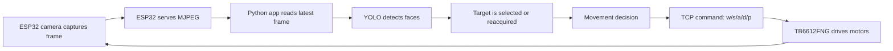

# How It Works

This project is a simple embedded computer-vision control loop with two
runtime components:

1. the ESP32 robot firmware
2. the self-contained Python vision and control app in `esp_app.py`

## 1. Robot firmware

The firmware in `espcam.cpp`:

- initializes the camera
- starts a Wi-Fi access point
- serves a live MJPEG stream
- listens for TCP movement commands
- drives the TB6612FNG motor controller

### Camera stream

The camera captures frames and stores the latest JPEG in memory. An HTTP
server exposes the stream at `/stream` using multipart MJPEG output. The
Python app reads this stream with the `MjpegStream` class in `esp_app.py`.

### Motor control

The firmware accepts commands such as:

```text
w, 180
s, 140
a, 220
d, 220
p, 0
```

The commands map to forward, backward, left, right, and stop behavior. The
second value is a PWM/speed value from `0` to `255`.

### Wi-Fi access point

The board runs in access-point mode, so the computer connects directly to the
robot without a separate router.

## 2. Desktop transport layer

The transport section of `esp_app.py` contains:

- `MjpegStream` — opens the stream and extracts JPEG frames
- `RobotCommandClient` — sends movement commands over TCP

`MjpegStream` keeps a bounded byte buffer and discards stale intermediate
frames so the worker processes recent video instead of building latency.
`RobotCommandClient` sends CRLF-terminated commands and suppresses duplicate
movement commands. Stop commands can be forced through immediately.

## 3. Vision and recognition

The vision section of `esp_app.py` loads a supported YOLO face model and
returns bounded face boxes with confidence values.

### Embeddings

The app tries to use InsightFace/ArcFace embeddings for appearance matching.
If InsightFace is unavailable, it uses a deterministic image-statistics
embedding fallback. The fallback keeps target tracking functional but is less
reliable for recognizing a person across different views.

### Target selection and memory

When the user clicks a face, the app creates a session target profile
containing:

- relative width and height
- aspect ratio
- normalized center position
- an appearance embedding

The target is persisted as `memory/target.json`. Named familiar-face
memories use additional JSON files. Each memory can retain a small ensemble of
embeddings and is updated incrementally after confirmed matches.

### Reacquisition order

For each frame, the worker attempts to keep the target in this order:

1. bounding-box overlap with the previous target
2. distance from the previous target position
3. learned session profile similarity
4. matching against stored familiar-face memories

The target is retained through short detection gaps. After the loss window is
exceeded, the worker clears the active selection.

## 4. Movement decisions

The classifier compares the target with the frame center and face-size
thresholds. It can produce:

- `LEFT` or `RIGHT` — rotate to center the face
- `CLOSE` or `FAR` — move backward or forward to adjust distance
- `GOOD` — the target is aligned and at a suitable distance
- `NO TARGET` — there is no active target

The decision maps to `a`, `d`, `w`, `s`, or `p`. Turning speed increases with
horizontal offset, while distance decisions use detected face size relative to
the frame.

## 5. Desktop application

`esp_app.py` ties the stream, model, target state, recognition, and motor
control together.

### UI flow

The app displays:

- the main video canvas
- a crop preview of the tracked target
- model, stream, and robot status
- model loading and confidence controls
- target memory similarity details
- the current movement decision

The app loads models and processes video outside the Tkinter event loop so the
interface remains responsive.

### Worker thread

The vision worker:

1. connects to the MJPEG stream
2. detects faces
3. handles click-to-select requests
4. reacquires and updates the target
5. updates persistent face memory
6. classifies movement
7. sends the robot command
8. publishes rendered frames and status events to the UI

The Tkinter thread polls an event queue and consumes only the latest rendered
frame. Older rendered frames are dropped instead of queued, limiting display
latency.

## 6. Overall closed loop



## 7. Persistence and shutdown

Face memories are stored as JSON in `memory/`. The files contain normalized
embeddings, geometry statistics, confidence, and tracking counters. Existing
memory files remain compatible with the consolidated app.

When the worker stops, it releases the MJPEG stream and sends a stop command
to the robot. The Stop button and `Esc` key also issue a direct stop request
so they do not need to wait for a complete vision iteration.

## 8. Why it works well for a demo

The ESP32 handles networking, camera capture, and motor control while the
computer handles heavier machine-vision work. The single-file desktop app
keeps the demo easy to run and makes the complete control loop easy to inspect
and extend.
